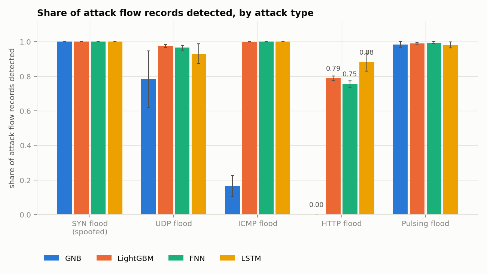
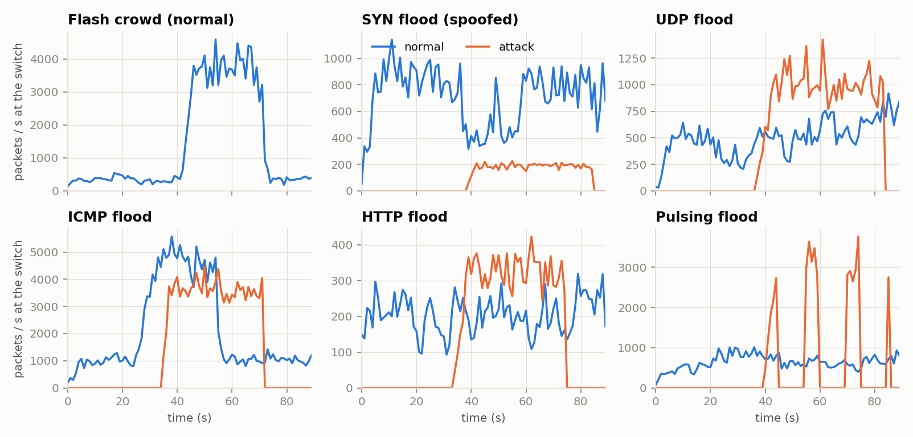
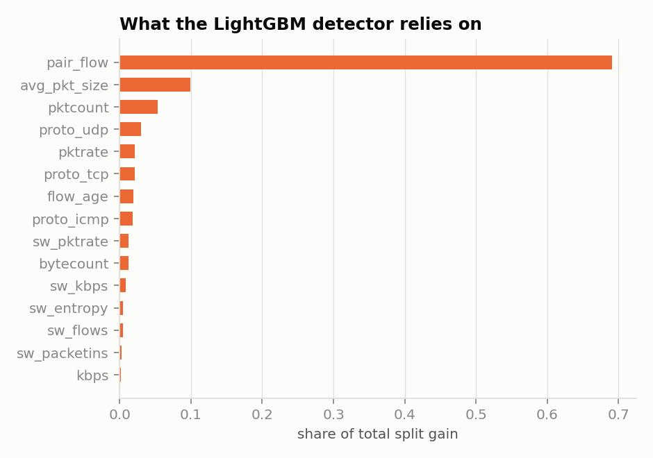
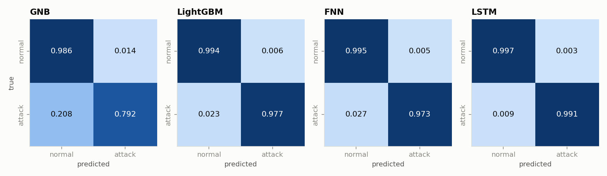
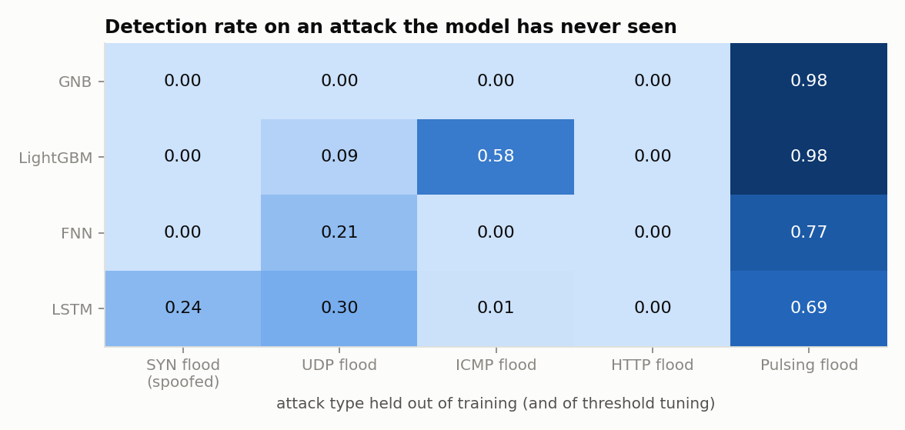
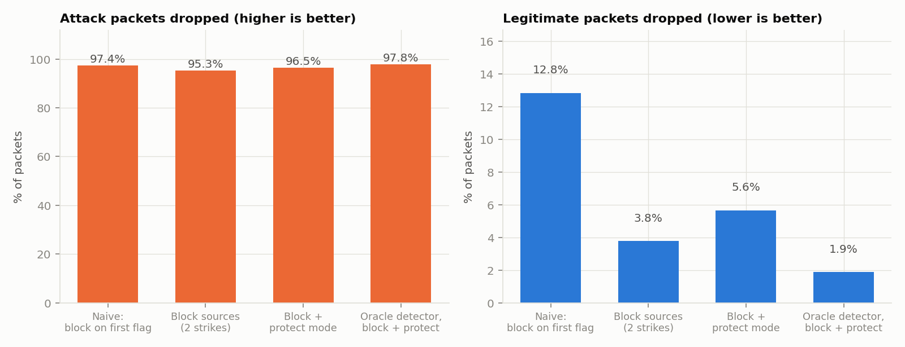
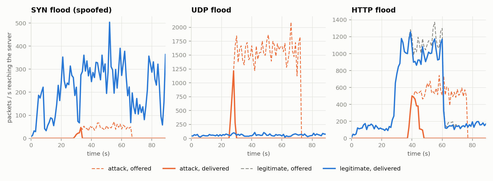
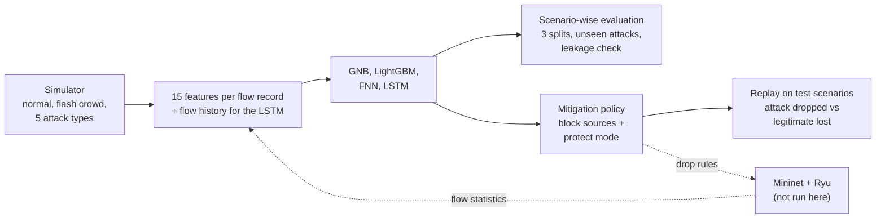

# DDoS Detection and Mitigation Using AI


[](https://github.com/Darani-karthik/ddos-detection-mitigation-ai/actions/workflows/tests.yml)

**Spotting DDoS floods in a software-defined network with four machine-learning models (Gaussian Naive Bayes, LightGBM, a feed-forward network and an LSTM) and stopping them with a mitigation policy, all evaluated without data leakage and with the costs of false alarms counted.**



## Read this first: the data is simulated

The original course project trained on traffic generated in Mininet. That data set is not available, so this repository generates its own with a documented **flow-level simulator** ([`ddos_ai/simulate.py`](ddos_ai/simulate.py)): normal client traffic, legitimate flash crowds, and five kinds of attack, polled once per second like an SDN controller would. Every number below measures how the models behave **on that simulator**. It is a controlled testbed for comparing methods and mitigation policies, not a claim about real networks, where attacks are usually harder to tell apart. The Mininet and Ryu scripts that would produce real data are included, but they have **not been run** (see [Using real Mininet traffic](#using-real-mininet-traffic)).

## Overview

A DDoS attack floods a server with traffic from many sources until legitimate users are locked out. In an SDN the controller sees per-flow statistics from the switch every few seconds, which is enough to tell the two apart *if* the classifier is good and the response is careful: blocking the wrong source, or dropping a legitimate flash crowd, hurts as much as the attack.

This repository covers both halves:

1. **Detection.** Four classifiers decide for every flow record whether it belongs to an attack. Each sees the same data, features and splits.
2. **Mitigation.** A policy turns scores into drop rules (block sources that keep misbehaving, and switch to a "protect mode" against spoofed floods), and a replay measures how much attack traffic it stops and how much legitimate traffic it costs.

| # | Model | Idea |
|---|---|---|
| 1 | Gaussian Naive Bayes (GNB) | fast probabilistic baseline on log-scaled features |
| 2 | LightGBM | gradient-boosted trees on the raw features |
| 3 | FNN | feed-forward network, 64-32-1, on one flow record |
| 4 | LSTM | recurrent network over the same flow's last 5 windows (rates over time) |

The data set: 120 scenarios of 90 seconds with 489,315 flow records in total, 21.5% of them attack records.

| Scenario kind | Scenarios | Flow records | of which attack |
|---|---|---|---|
| flash | 8 | 53,924 | 0 |
| http | 18 | 59,078 | 5,279 |
| icmp | 18 | 62,123 | 4,758 |
| mixed | 12 | 64,656 | 25,142 |
| normal | 16 | 30,378 | 0 |
| pulse | 12 | 49,429 | 1,188 |
| syn_spoof | 18 | 117,109 | 63,733 |
| udp | 18 | 52,618 | 5,145 |
| **total** | 120 | 489,315 | 105,245 |



## Results

### Detection

Scored on **held-out scenarios**: 28 of the 120 scenarios (about 105,000 to 116,000 flow records) that no model saw in training or tuning. Mean ± std over **3 different scenario splits** (split seed = model seed). The decision threshold is tuned on separate validation scenarios. "False-alarm rate" is the share of normal flows flagged as attacks.

| Model | Accuracy % | Precision % | Recall % | F1 % | False-alarm rate % | ROC-AUC | PR-AUC |
|---|---|---|---|---|---|---|---|
| GNB | 95.47 ± 0.67 | 90.02 ± 4.35 | 83.87 ± 3.53 | 86.76 ± 3.04 | 2.03 ± 0.91 | 0.9048 ± 0.0236 | 0.8869 ± 0.0277 |
| LightGBM | 98.79 ± 0.29 | 95.34 ± 1.53 | 98.10 ± 0.37 | 96.70 ± 0.77 | 1.08 ± 0.37 | 0.9991 ± 0.0001 | 0.9965 ± 0.0009 |
| FNN | 98.82 ± 0.34 | 95.76 ± 1.89 | 97.80 ± 0.39 | 96.76 ± 0.99 | 0.97 ± 0.42 | 0.9988 ± 0.0005 | 0.9960 ± 0.0017 |
| LSTM | 99.49 ± 0.17 | 98.54 ± 0.36 | 98.58 ± 0.79 | 98.56 ± 0.53 | 0.31 ± 0.04 | 0.9993 ± 0.0006 | 0.9978 ± 0.0016 |

Pooled scores are dominated by the spoofed SYN flood, which makes up about 60% of all attack records (one record per spoofed source) and which every model catches. The fairer picture is the **detection rate per attack type**:

| Model | SYN flood | UDP flood | ICMP flood | HTTP flood | Pulsing flood | Macro recall | False alarms, normal | False alarms, flash crowd |
|---|---|---|---|---|---|---|---|---|
| GNB | 100.0 | 78.4 ± 16.3 | 16.5 ± 6.1 | 0.0 | 98.3 ± 1.6 | 58.6 ± 4.2 | 4.52 ± 2.38 | 0.38 ± 0.29 |
| LightGBM | 100.0 | 97.4 ± 0.9 | 99.9 ± 0.1 | 78.8 ± 1.3 | 99.0 ± 0.4 | 95.0 ± 0.2 | 0.69 ± 0.37 | 0.65 ± 0.25 |
| FNN | 100.0 | 96.5 ± 1.4 | 99.9 ± 0.0 | 75.4 ± 1.8 | 99.5 ± 0.5 | 94.3 ± 0.1 | 0.61 ± 0.53 | 0.55 ± 0.33 |
| LSTM | 100.0 | 93.0 ± 5.8 | 100.0 | 88.1 ± 5.2 | 98.0 ± 1.7 | 95.8 ± 1.8 | 0.17 ± 0.09 | 0.14 ± 0.06 |

*Macro recall* is the mean over the five attack types. "Flash crowd" is the false-alarm rate on a legitimate surge of traffic that looks like an attack in aggregate.

**What the numbers say**

- **The LSTM is the best detector here**: F1 98.6% with only 0.31% false alarms, against 96.7% for LightGBM and 96.8% for the FNN. The gap to LightGBM and the FNN (about 1.8 points of F1) is larger than the split-to-split spread, but it is three splits on one simulator, so treat it as indicative.
- **LightGBM and the FNN are indistinguishable** (F1 96.7 vs 96.8, well inside their std). LightGBM trains in about a second and scores a poll window in milliseconds, which is why it is the model exported for the controller ([`models/lightgbm.txt`](models/lightgbm.txt)).
- **GNB is clearly last** (F1 86.8%). Its Gaussian assumption fits skewed rate features badly: it misses most ICMP floods (only 16.5% recall) and every HTTP flood.
- **The HTTP flood is the hard case**: bots with real addresses sending normal-looking requests at moderate rates, close to legitimate heavy users and flash crowds. LightGBM finds 79% of it, the FNN 75%, the LSTM 88%. The LSTM's edge may come from seeing how a flow's rate evolves over several windows, but that was not isolated by an ablation here. It cannot help against spoofed floods, whose flows are seen once.
- **One feature carries most of the work.** 69% of LightGBM's split gain is `pair_flow` (is there traffic coming back?), see the figure below. The simulator makes that cue very informative: spoofed and one-way floods have no return flow, legitimate conversations do. Floods that look like conversations defeat it: the HTTP flood always has return traffic, and it is where the models do worst (the ICMP floods, which have it in half of the scenarios, are still caught through packet size and rate). Whether real traffic offers the same cue is not known from this data.
- **Per-type numbers rest on few scenarios** (about 3-5 test scenarios per attack type per split), which is why some standard deviations are large (for example the LSTM on the UDP flood).



<table>
  <tr>
    <td></td>
  </tr>
</table>

*Confusion matrices on the test scenarios of the first split, each row (true class) sums to 1.* The full tables, including metrics at the natural 0.5 threshold, are in [`results/summary.md`](results/summary.md); every run is in [`results/metrics/`](results/metrics).

### Attacks the model has never seen

The previous numbers are for attack types the models were trained on. **Leave-one-attack-out** removes one attack type completely (also from threshold tuning) and tests on scenarios of exactly that attack. Cells show recall % / false-alarm rate %:

| Model | SYN flood (spoofed) held out | UDP flood held out | ICMP flood held out | HTTP flood held out | Pulsing flood held out |
|---|---|---|---|---|---|
| GNB | 0.0 / 14.53 | 0.0 / 0.00 | 0.0 / 0.06 | 0.0 / 1.26 | 97.7 / 2.68 |
| LightGBM | 0.0 / 2.61 | 8.9 / 0.70 | 57.7 / 0.82 | 0.0 / 0.13 | 98.4 / 0.50 |
| FNN | 0.0 / 1.93 | 20.7 / 0.34 | 0.0 / 1.24 | 0.0 / 0.14 | 76.5 / 0.35 |
| LSTM | 23.5 / 1.37 | 29.7 / 0.08 | 0.5 / 0.70 | 0.0 / 0.13 | 68.9 / 0.11 |

ROC-AUC on the same scenarios, which does not depend on the threshold:

| Model | SYN flood (spoofed) held out | UDP flood held out | ICMP flood held out | HTTP flood held out | Pulsing flood held out |
|---|---|---|---|---|---|
| GNB | 0.410 | 0.072 | 0.023 | 0.265 | 0.996 |
| LightGBM | 0.508 | 0.978 | 0.973 | 0.683 | 1.000 |
| FNN | 0.822 | 0.957 | 0.060 | 0.423 | 0.970 |
| LSTM | 0.919 | 0.966 | 0.717 | 0.347 | 0.961 |



**Supervised detectors only recognise what they have been shown.** For the spoofed SYN flood, the UDP flood and the HTTP flood, recall is at most 30% for every model. The pulsing flood, which is a UDP or TCP flood with gaps in it, is mostly caught (GNB and LightGBM above 97%) because the training set contains similar floods. The ROC-AUC shows that some models still *rank* an unseen attack above normal traffic (LightGBM on the UDP flood, the LSTM on the SYN flood), but a threshold tuned without the attack does not carry over, and several AUCs are well below 0.5, meaning the model confidently calls that attack normal. A deployment needs retraining as new attacks appear, or an anomaly detector next to the classifier.

### Why scenario-wise evaluation matters

A random split of the flow records, the easy way to do it, puts records of the same run (and of the same bot, in a different second) in both training and test data. Here is the same LightGBM, with the same features and tuning, evaluated both ways ([`ddos_ai/experiments.py`](ddos_ai/experiments.py), `run_leaky`):

| Evaluation | F1 % | ROC-AUC | Macro recall % | HTTP-flood recall % | Test scenarios also in training |
|---|---|---|---|---|---|
| Scenario-wise split (used everywhere else) | 96.70 ± 0.77 | 0.9991 ± 0.0001 | 95.0 ± 0.2 | 78.8 ± 1.3 | 0 |
| Random split of flow records (leaky) | 98.79 ± 0.08 | 0.9999 ± 0.0000 | 97.7 ± 0.3 | 90.3 ± 0.9 | 120 |

The leaky evaluation overstates the F1 score by about 2.1 points and the recall on the HTTP flood by about 11 points: records of one bot look alike from one second to the next. The simulator's floods are easy enough that the effect is modest; on harder data it would be larger. Every other number in this repository uses the scenario-wise split.

### Mitigation

Detection alone does not stop a flood. The policy ([`ddos_ai/mitigation.py`](ddos_ai/mitigation.py)) is replayed over the 28 test scenarios of the first split, with the detectors' scores and thresholds:

1. **Block sources** whose flows are flagged in 2 consecutive windows, for 30 windows (renewed while they keep misbehaving). The protected server is never blocked.
2. **Protect mode** for spoofed floods: when 20 or more sources are flagged in one window, only sources seen behaving normally for 3 windows are let through for the next 8 windows. Every address of a spoofed flood appears once, so blocking addresses cannot work.

| Detector / policy | Attack packets dropped % | Legit packets dropped % | Legit dropped in flash crowds % | Peak server load cut % | Median windows to mitigate | Attack scenarios never mitigated |
|---|---|---|---|---|---|---|
| no mitigation | 0.0 | 0.0 | 0.0 | 0.0 | n/a | 22 |
| LightGBM / naive (block on first flag) | 97.4 | 12.8 | 23.9 | 65.4 | 1 | 4 |
| LightGBM / block sources (2 strikes) | 95.3 | 3.8 | 8.9 | 54.2 | 2 | 4 |
| LightGBM / block + protect mode | 96.5 | 5.6 | 8.9 | 56.0 | 2 | 0 |
| LSTM / naive (block on first flag) | 97.6 | 5.5 | 0.0 | 66.0 | 1 | 4 |
| LSTM / block sources (2 strikes) | 96.1 | 3.8 | 0.0 | 54.7 | 2 | 4 |
| LSTM / block + protect mode | 97.3 | 5.7 | 0.0 | 56.5 | 2 | 0 |
| oracle detector / block + protect mode | 97.8 | 1.9 | 0.0 | 57.1 | 2 | 0 |

The *oracle* row feeds the true labels to the same policy: it shows what the policy costs even when detection is perfect. "Windows to mitigate" is the median time from the first attack packet until 90% of a window's attack packets are dropped; 2 is the minimum (one window to see the attack, a second strike to confirm it).



**What the numbers say**

- **The policy design matters as much as the detector.** Blocking on the first flag stops 97.4% of attack packets but drops 12.8% of legitimate ones, 23.9% during flash crowds, with the LightGBM detector. Requiring two strikes cuts that to 3.8%.
- **Blocking addresses cannot stop a spoofed flood.** Two-strike blocking never mitigated 4 of the 22 attack scenarios in the test set, all of them spoofed SYN floods; protect mode mitigated all of them (96.5% of attack packets dropped, 5.6% of legitimate packets lost).
- **Protect mode has a price even with perfect detection**: the oracle still loses 1.9% of legitimate packets, because legitimate newcomers during an attack are indistinguishable from unknown sources.
- **The two detectors give similar attack coverage and similar total collateral** (5.7% for the LSTM, 5.6% for LightGBM), but it falls in different places: during flash crowds the LSTM loses 0.0% of legitimate packets, LightGBM 8.9%.
- **Reaction time is the floor.** Fixed-address and spoofed floods are mitigated in 2 to 2.5 windows. The HTTP flood takes 9 windows (median) with the LightGBM detector because it catches that flood less reliably; the oracle mitigates it in 2.
- **Peak load on the server falls by only about 55%, far less than the share of attack packets dropped.** For the large floods (UDP, ICMP) the peak after mitigation is the first one or two windows, before any rule exists. For the SYN flood, which is small next to legitimate traffic, the peak after mitigation is the legitimate traffic itself.



*Packets per second reaching the server in one test scenario of each kind (LightGBM detector, block + protect mode). Dashed: what was offered; solid: what got through.*

## Method



The full description, with every parameter of the simulator, the models and the policy, is in [`docs/methodology.md`](docs/methodology.md). In short:

- **Flow records.** One row per flow entry and poll window: source, destination, protocol, packets, bytes, flow age, whether the reverse flow is active, plus label. IP addresses are never model inputs.
- **15 features.** Per-flow rates and sizes, protocol, flow age, pair flow, and switch-level context of the same window (active flows, new flows, total rate, entropy). Only the current and past windows are used.
- **Scenario-wise split.** 60 / 15 / 25% of the scenarios for train / validation / test, stratified by kind. No scenario is ever on both sides (asserted in the code and by a unit test).
- **Threshold and early stopping** use the validation scenarios only; the test scenarios are scored once at the end.
- **Class imbalance** is handled by class weights (FNN, LSTM) and the tuned threshold (all models).
- **Seeds.** Fixed. Re-running `run_all` from a fresh clone with an empty cache reproduces every number in `results/metrics` exactly (GPU or different BLAS builds could in principle add tiny differences).

## Reproduce

```bash
git clone https://github.com/Darani-karthik/ddos-detection-mitigation-ai.git
cd ddos-detection-mitigation-ai

python -m venv .venv
source .venv/bin/activate          # Windows: .venv\Scripts\activate
pip install -r requirements.txt

python -m ddos_ai.run_all          # simulates the data and rebuilds results/ and models/
```

`run_all` took about 6 minutes on a 16-core laptop (TensorFlow on the CPU). `python -m ddos_ai.run_all --quick --out results_quick --models-dir models_quick` is a 30-second smoke run on a smaller data set. Run the tests with `python -m pytest` (the FNN and LSTM tests are skipped when TensorFlow is not installed).

Tested with Python 3.10, NumPy 2.2, pandas 2.3, scikit-learn 1.7, LightGBM 4.7, TensorFlow 2.21 (Keras 3.12).

## Using real Mininet traffic

The folder [`sdn/`](sdn) contains a Mininet topology, an experiment script that generates normal traffic followed by an attack (`hping3`, `curl`), and a Ryu controller app that records flow statistics, scores them and installs drop rules. [`docs/sdn-deployment.md`](docs/sdn-deployment.md) walks through collecting labelled data, training on it (`python -m ddos_ai.run_all --data labeled.csv`) and defending.

**Not run:** the machine this was developed on runs Windows. The Python these scripts reuse (flow tracking, scoring, policy, labelling) is unit-tested; the Mininet / Open vSwitch / Ryu glue is not, and the committed LightGBM model was trained on simulated data. Treat it as a starting point.

## Repository structure

```
.
├── ddos_ai/
│   ├── simulate.py          # the flow-level traffic simulator
│   ├── features.py          # 15 features, flow histories for the LSTM, scaling
│   ├── data.py              # data set building, scenario-wise split, CSV loader
│   ├── models.py            # GNB, LightGBM, FNN, LSTM
│   ├── evaluation.py        # threshold tuning, metrics, per-attack breakdown
│   ├── experiments.py       # main comparison, leave-one-attack-out, leakage check, mitigation replay
│   ├── mitigation.py        # block + protect-mode policy and the replay
│   ├── runtime.py           # FlowTracker and OnlineDetector for the controller
│   ├── labeling.py          # labels a Mininet capture for training
│   ├── plots.py  report.py  # figures and results/summary.md
│   └── run_all.py           # runs everything
├── sdn/                     # Mininet topology, experiment script, Ryu controller app (not run here)
├── tests/                   # simulator, features, split, metrics, policy, runtime, models
├── results/                 # summary.md, per-run metrics (JSON), figures
├── models/                  # the LightGBM model and threshold for the controller
├── docs/                    # methodology.md, sdn-deployment.md
├── data/                    # data layout and a small sample (the data set itself is simulated on demand)
├── pyproject.toml  requirements.txt
└── .github/workflows/       # CI: tests on Python 3.10 and 3.12
```

## Limitations and next steps

- **Simulated data.** The biggest caveat. The floods are easier to separate than most real ones (one feature, `pair_flow`, does most of the work), so near-perfect scores on several attack types say little about real networks. The first next step is the same evaluation on public data generated with Mininet and Ryu, such as the SDN DDoS data set of Ahuja et al. (Mendeley Data, [doi:10.17632/jxpfjc64kr.1](https://doi.org/10.17632/jxpfjc64kr.1)), and on a capture from the scripts in `sdn/`.
- **No generalisation to unseen attacks** (see the leave-one-attack-out results). Anomaly detection, or periodic retraining, is needed alongside the classifiers.
- **Few scenarios per attack type in each test split**, so per-type recall has real uncertainty. More splits or cross-validation over scenarios would narrow it.
- **Replay, not a live network.** It assumes attackers and TCP do not react to the drops and that dropped traffic stays visible in the statistics. An adaptive attacker, or one that deliberately mimics legitimate traffic, is not modelled at all.
- **One switch, one victim.** The Ryu app is written for a single switch.
- **Untuned models.** Hyperparameters are reasonable defaults with early stopping, not searched. Probabilities are not calibrated.
- **Research code, not a product.** Do not put it in front of a production network unattended.

## Credits and references

Originally a course project at the Amrita School of Artificial Intelligence, Coimbatore (Amrita Vishwa Vidyapeetham), module 23MAT204 *Mathematics for Intelligent Systems 3*, reported in November 2024 as "DDoS Detection using ML". This repository is a cleaned-up, extended re-implementation by **Darani Karthik**: a documented simulator in place of the Mininet data, an evaluation that cannot leak, and the mitigation stage the report listed as future work. How its numbers relate to the report's is explained in [`docs/methodology.md`](docs/methodology.md#7-relation-to-the-original-report); they are not comparable.

Built with scikit-learn, LightGBM, TensorFlow / Keras and matplotlib; the SDN scripts target Mininet and Ryu.

Released under the [MIT License](LICENSE).
